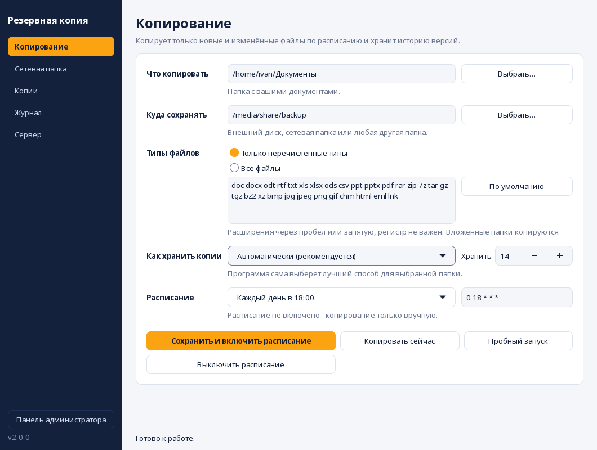
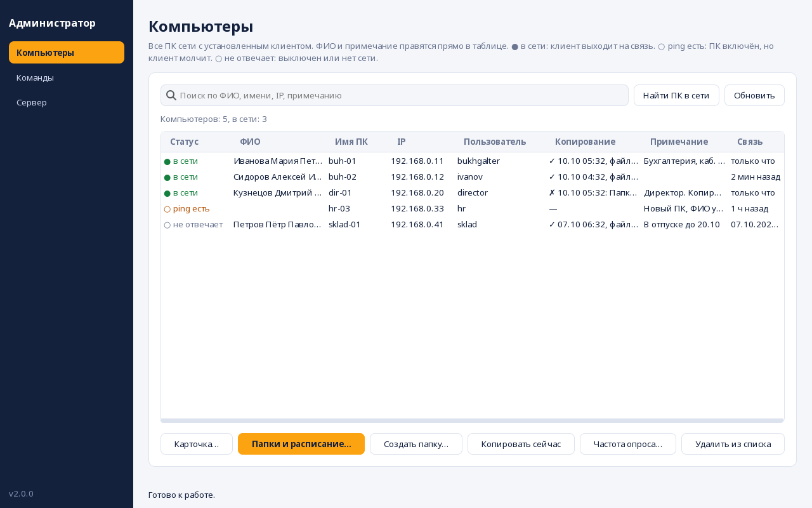

# crontab-save

Программа для резервного копирования документов с графическим окном настройки.
Копирует только **новые и изменённые** файлы, запускается **по расписанию** и хранит
**историю версий**, чтобы можно было вернуть файл в том виде, в каком он был вчера.

## Запуск

Вся программа - один файл `crontab-save.py`, ничего устанавливать через pip не нужно.

Нужны Python 3.9+, GTK 3 с PyGObject и rsync. В RED OS GTK обычно уже установлен.

```bash
sudo dnf install -y python3-gobject gtk3 rsync cronie   # RED OS / Fedora
# sudo apt install python3-gi gir1.2-gtk-3.0 rsync cron  # Debian / Ubuntu
python3 crontab-save.py
```



Откроется окно с боковым меню: Копирование, Сетевая папка, Копии, Журнал и Сервер. Если не хватает программ (rsync, cron, autofs,
cifs-utils), сверху появится жёлтая полоса с кнопкой «Установить».

### Раздел «Копирование»

1. Выберите папку, которую копируем, и папку, куда складываем копии.
2. Выберите типы файлов (по умолчанию документы, таблицы, презентации, PDF, архивы,
   картинки, письма) или «Все файлы».
3. Выберите расписание и нажмите **«Сохранить и включить расписание»**.

Кнопка «Пробный запуск» показывает, что было бы скопировано, ничего не копируя.

### Раздел «Сетевая папка»

Подключает папку на сервере Windows/Samba (SMB) через autofs. Введите адрес, имя
подключения, пользователя, домен и пароль. Программа запросит пароль администратора
и после подключения предложит сохранять копии в эту папку.

### Разделы «Копии» и «Журнал»

Список сохранённых копий (двойной щелчок открывает папку) и журнал работы.
**Чтобы восстановить файл**, откройте нужную копию и скопируйте файл оттуда.

## Как хранятся копии

| Режим | Что получается |
|---|---|
| **Снимки** | Папка `snapshots/ГГГГ-ММ-ДД_ЧЧММСС` на каждый запуск. Файлы, которые не менялись, не копируются заново, а подключаются жёсткой ссылкой на прошлый снимок (`rsync --link-dest`). Каждый снимок выглядит как полная копия, но занимает место только за изменения. |
| **Зеркало + архив** | Папка `current` с актуальной копией и `archive/…` с прежними версиями изменённых и удалённых файлов. Подходит для SMB и FAT, где нет жёстких ссылок. |
| **Автоматически** | Программа проверяет приёмник и выбирает режим сама. |

Старше заданного числа копий (по умолчанию 14) удаляются автоматически. Удаляются только
папки с именем вида `ГГГГ-ММ-ДД_ЧЧММСС`, чужие файлы рядом не затрагиваются.

## Оформление

Окно в стиле «Панель управления»: тёмно-синее боковое меню (Копирование, Сетевая папка, Копии,
Журнал), оранжевый акцент, настройки в белых карточках на светлом фоне. Вся тема лежит в
`crontab-save.py` (раздел «Оформление окна»), цвета меняются в одном словаре `PALETTE`.

## Панель администратора

Одна программа - два режима. На ПК сотрудников работает **клиент** (окно из предыдущих разделов), а на
ПК администратора - **панель** вместе с **сервером**. Панель открывается кнопкой **«Панель администратора»**
внизу левого меню обычного окна или командой `python3 crontab-save.py admin`.



В панели:

- список всех ПК с ФИО, именем, IP, пользователем, итогом последнего копирования и примечанием;
- ФИО и примечание правятся прямо в таблице или в карточке ПК и **сохраняются на сервере** (база SQLite);
- **IP обновляется сам**: по адресу, с которого пришёл запрос, а для давно молчащих ПК - по имени
  компьютера; кнопка «Найти ПК в сети» просматривает подсеть и подхватывает найденные адреса;
- удалённые действия над одним или несколькими ПК сразу: сменить папки, режим, расписание, **создать
  папку** там, где укажет администратор (можно сразу назначить её источником или местом копий),
  запустить копирование;
- журнал команд (выполнена, ошибка, ждёт ПК) с отменой, поиск по списку, частота опроса.

### Быстрый старт

1. На ПК администратора: кнопка «Панель администратора» в окне программы (или `python3 crontab-save.py admin`). При первом запуске панель предложит поднять сервер
   здесь. Ключ для компьютеров показан в разделе «Сервер».
   Чтобы сервер работал постоянно, а не пока открыта панель: `python3 crontab-save.py server`
   (как служба: `python3 crontab-save.py server-unit`).
2. Откройте порты: `sudo firewall-cmd --permanent --add-port=8765/tcp --add-port=8766/udp && sudo firewall-cmd --reload`.
   (8765 - работа, 8766 - автопоиск сервера клиентами.)
3. На каждом ПК сотрудника: окно crontab-save, раздел «Сервер»: «Найти в сети», ключ, «Подключить».
   Или командой: `python3 crontab-save.py agent-setup --key КЛЮЧ` (адрес сервера найдётся сам;
   если нет - добавьте `--server 192.168.0.10`).

### Как это устроено и что важно знать

- **Клиент сам обращается к серверу**, сервер к ПК не подключается: на ПК сотрудников нет открытых портов.
  Клиент запускается cron раз в минуту, но по сети выходит на связь только раз в **интервал**, который
  задаёт администратор (по умолчанию 5 минут; для всех - в разделе «Сервер», для одного ПК - «Частота
  опроса»). Команда выполняется при ближайшем обращении, поэтому ждать её до интервала. Минимум 1 минута.
- **Команды выполняются с правами пользователя ПК**, а не root: пароль администратора не нужен, но и недоступное
  пользователю (чужие домашние папки, системные каталоги) создать нельзя. Результат команды виден в журнале.
  Каждая команда записывается в журнал клиента.
- **Защита:** общий секретный ключ. Каждый запрос и каждый ответ подписаны (HMAC-SHA256 с временем и
  одноразовым числом), поэтому без ключа нельзя ни отдать команду, ни подделать ответ сервера, ни повторить
  перехваченный запрос. Ключ администратора отдельный: ПК, у которого есть только ключ клиентов, управлять
  другими ПК не может. **Трафик не шифруется**, поэтому используйте только в доверенной локальной сети.
  Ключи лежат в `~/.config/crontab-save/` с правами 0600.
- Часы на ПК не должны расходиться с сервером больше чем на 10 минут (иначе запрос отклоняется).
- Если ПК не выходит на связь, он показывается как «ping есть» (включён, но клиент молчит) или «не отвечает».
  ФИО, примечания и очередь команд при этом сохраняются.

## Командная строка

Cron вызывает ту же программу без окна:

```bash
python3 crontab-save.py run                 # выполнить копирование
python3 crontab-save.py run --dry-run       # показать, что будет скопировано
python3 crontab-save.py status              # текущие настройки и расписание
python3 crontab-save.py install-cron --schedule '0 18 * * 1-5'
python3 crontab-save.py remove-cron
```

Для сервера и клиента:

```bash
python3 crontab-save.py admin                    # панель администратора
python3 crontab-save.py server                   # сервер без окна (--port, --bind, --no-discovery)
python3 crontab-save.py server-info              # ключи сервера
python3 crontab-save.py agent-setup --key КЛЮЧ   # подключить этот ПК (--server адрес, если автопоиск не сработал)
python3 crontab-save.py agent-status             # состояние связи с сервером
python3 crontab-save.py agent-remove             # отключить этот ПК
python3 crontab-save.py discover                 # найти серверы в сети
```

Настройки хранятся в `~/.config/crontab-save/config.json`, журнал - в
`~/.local/state/crontab-save/backup.log`.

## Что исправлено по сравнению с прежним `backup.sh`

Старый bash-скрипт остался в истории git (коммит `abe3bc1`).

- **Подпапки не копировались.** Фильтр `--include=*.pdf --exclude=*` отсекал все папки,
  поэтому копировались только файлы из корня. Теперь добавлены `--include=*/` и
  `--prune-empty-dirs`.
- **Регистр расширений.** Файлы `.PDF` и `.Doc` раньше пропускались.
- **Копирование раз в минуту** (`* * * * *`) без защиты от наложения запусков. Теперь
  расписание выбирается, а второй запуск не стартует, пока идёт первый.
- **Затирался весь crontab пользователя** (`crontab -u … -`). Теперь правится только
  своя строка, помеченная `# crontab-save`.
- **Нет истории версий и учёта удалений:** изменённый файл перезаписывал прежний.
- **Файл учётных данных** содержал секцию `[smb]`, которой формат cifs не знает.
  Пароль писался через `echo -e` (ломался на `\`).
- **Нет `uid`/`gid` в строке монтирования**, поэтому файлы на шаре принадлежали root
  с правами 0600 и пользователь не мог туда писать.
- **Путь `/media/share/backup/`** был прописан жёстко и не зависел от введённого имени
  подключения; поле «Папка для синхронизации» читалось, но не использовалось.
- **`grep`/`sed` по подстроке** в `/etc/auto.samba` могли задеть чужие записи.
  Теперь записи ищутся по метке, а чужая запись с тем же именем не перезаписывается.
- **Если сетевая папка не подключена,** копии молча ложились на локальный диск в пустую
  папку. Теперь копирование останавливается с понятной ошибкой.
- Скрипт целиком работал от root; теперь окно запускается от обычного пользователя,
  а права администратора запрашиваются только на настройку SMB и установку пакетов.

Отличия по сравнению со старым скриптом: нет запуска `gnome-disks` и выбора пользователя
из `/home` (программа настраивает копирование для того пользователя, который её запустил).

## Тесты

```bash
python3 -m unittest discover -s tests
```

Тесты окна требуют графического сеанса. Без него они пропускаются; на сервере или в
контейнере запускайте через виртуальный экран:

```bash
xvfb-run -a python3 -m unittest discover -s tests
```
