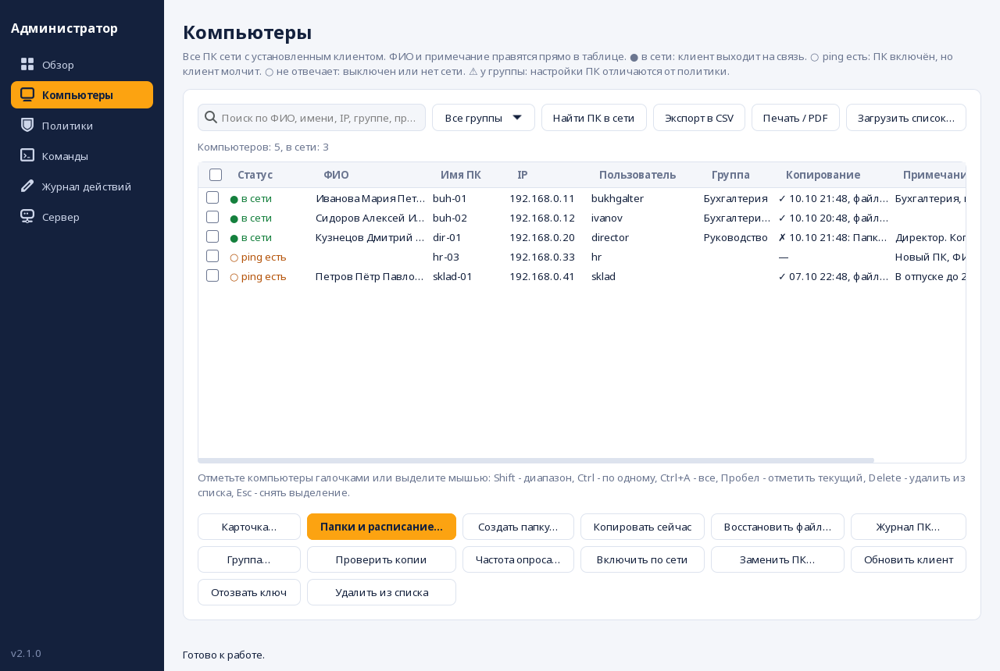

# crontab-save

Программа для резервного копирования документов с графическим окном настройки.
Копирует только **новые и изменённые** файлы, запускается **по расписанию** и хранит
**историю версий**, чтобы можно было вернуть файл в том виде, в каком он был вчера.

## Запуск

Вся программа - один файл `crontab-save.py`, ничего устанавливать через pip не нужно.

Нужны Python 3.9+, GTK 3 с PyGObject и rsync. В RED OS GTK обычно уже установлен.

```bash
sudo dnf install -y python3-gobject gtk3 rsync cronie   # RED OS / Fedora
# sudo apt install python3-gi gir1.2-gtk-3.0 rsync cron  # Debian / Ubuntu
python3 crontab-save.py
```


Откроется окно с боковым меню: Копирование, Сетевая папка, Копии, Восстановление, Журнал и Сервер. Если не хватает программ (rsync, cron, autofs,
cifs-utils), сверху появится жёлтая полоса с кнопкой «Установить».

### Раздел «Копирование»

1. Выберите папку, которую копируем, и папку, куда складываем копии.
2. Выберите типы файлов (по умолчанию документы, таблицы, презентации, PDF, архивы, картинки, письма) или «Все файлы».
3. Выберите расписание и нажмите **«Сохранить и включить расписание»**.

Заданий может быть **несколько** (например, документы в одно место, почта в другое): у каждого свои папки и свой
cron. Раздел «Дополнительно» открывает остальные настройки:

| Настройка | Что делает |
|---|---|
| Не копировать | Папки и маски: `node_modules/`, `*.tmp`, `Загрузки/`. |
| Файлы больше N МБ, скорость | Пропускает слишком большие файлы, ограничивает скорость (КБ/с). |
| Низкий приоритет | Копирование идёт с `nice`/`ionice` и не мешает работать. |
| Уведомления | Всплывающее сообщение на рабочем столе: ничего, только ошибки или всё. |
| Свободное место | Перед копированием оценивается объём; если места не хватит, старые копии удаляются (по желанию) или выдаётся понятная ошибка. |
| При подключении диска | Копирование запускается, когда подключили флешку или сетевую папку. |
| Догнать пропущенное | ПК был выключен, копии нет дольше N часов: копирование запустится при включении. |
| Проверка целостности | Раз в N дней сверяются контрольные суммы (см. ниже). |
| Упаковка и шифрование архивов | Режим «зеркало»: старые архивы версий упаковываются в `.tar.gz` и шифруются AES-256. |

Кнопка «Пробный запуск» показывает, что было бы скопировано, ничего не копируя.

### Раздел «Восстановление»

Введите часть имени файла (или маску `*.xlsx`): программа ищет по **всем** копиям, включая упакованные и
зашифрованные, и показывает каждую версию файла. «Восстановить на прежнее место» или «в папку…». Существующие
файлы **не затираются**: рядом появляется копия с пометкой «восстановлено». В консоли: `find` и `restore`.

### Раздел «Сетевая папка»

Подключает папку на сервере Windows/Samba (SMB) через autofs. Введите адрес, имя подключения, пользователя, домен и
пароль. Программа запросит пароль администратора и после подключения предложит сохранять копии в эту папку.

### Разделы «Копии» и «Журнал»

Список сохранённых копий (двойной щелчок открывает папку), кнопка **«Проверить целостность»** и журнал работы.
Проверка ловит порчу данных на диске: повреждённым считается файл, у которого размер и время те же, а содержимое
другое. Файлы, которые вы сами изменили после копирования, повреждёнными не считаются.

### Раздел «Сервер»

Подключение этого ПК к панели администратора (подробнее ниже), предложение обновить программу и кнопка
«Установить ярлык и команду».

## Как хранятся копии

| Режим | Что получается |
|---|---|
| **Снимки** | Папка `snapshots/ГГГГ-ММ-ДД_ЧЧММСС` на каждый запуск. Файлы, которые не менялись, не копируются заново, а подключаются жёсткой ссылкой на прошлый снимок (`rsync --link-dest`). Каждый снимок выглядит как полная копия, но занимает место только за изменения. |
| **Зеркало + архив** | Папка `current` с актуальной копией и `archive/…` с прежними версиями изменённых и удалённых файлов. Подходит для SMB и FAT, где нет жёстких ссылок. |
| **Автоматически** | Программа проверяет приёмник и выбирает режим сама. |

Старше заданного числа копий (по умолчанию 14) удаляются автоматически. Удаляются только
папки с именем вида `ГГГГ-ММ-ДД_ЧЧММСС`, чужие файлы рядом не затрагиваются.

## Оформление

Окно в стиле «Панель управления»: тёмно-синее боковое меню, оранжевый акцент, настройки в белых карточках на светлом фоне. Вся тема лежит в
`crontab-save.py` (раздел «Оформление окна»), цвета меняются в одном словаре `PALETTE`.

## Панель администратора

Одна программа - два режима. На ПК сотрудников работает **клиент** (окно выше), а на ПК администратора - **панель**
вместе с **сервером**. Панель открывается кнопкой **«Панель администратора»** внизу левого меню или командой
`python3 crontab-save.py admin`.




Разделы панели:

- **Обзор:** сколько ПК в сети, проблемы (копирование не удалось, давно нет копии, мало места, повреждения,
  нет связи), ПК вне политики, ПК с устаревшей программой и график объёма копирования за 30 дней.
- **Компьютеры:** все ПК с ФИО, именем, IP, пользователем, группой, итогом копирования и примечанием. ФИО и
  примечание правятся прямо в таблице и хранятся на сервере. Поиск, фильтр по группам, экспорт в CSV (открывается в
  Excel) и «Печать / PDF», загрузка списка из CSV. Над выбранными ПК (можно над несколькими сразу):
  - **Папки и расписание:** сменить папки, режим, время, исключения, лимиты и любые другие настройки, создать
    папки, выбрать задание или создать новое. Кнопка **«Обзор…»** показывает дерево папок самого ПК. Команду можно
    выполнить сразу или в заданное время («сегодня в 02:00»).
  - **Создать папку** там, где укажете (можно сразу назначить её источником или местом копий).
  - **Восстановить файл…** на ПК, **Журнал ПК…**, **Копировать сейчас**, **Проверить копии**.
  - **Группа…**, **Частота опроса…**, **Включить по сети** (Wake-on-LAN), **Заменить ПК…** (новый ПК получает
    ФИО, группу и настройки старого), **Обновить клиент**, **Отозвать ключ**, **Удалить из списка**.
- **Политики:** настройки, которые должны быть у всех ПК группы. Применяются кнопкой или поддерживаются
  автоматически: если настройки ПК разошлись с политикой, они возвращаются сами (не чаще раза в 10 минут).
- **Команды:** что отправлено и чем закончилось, ответы целиком, отмена ожидающих.
- **Журнал действий:** кто из администраторов и когда что менял.
- **Сервер:** адрес и ключи, оповещения по почте, администраторы и роли, резервная копия базы,
  обновление клиентов.

**IP обновляется сам:** по адресу, с которого пришёл запрос; для давно молчащих ПК - по имени компьютера; кнопка
«Найти ПК в сети» просматривает подсеть и подхватывает найденные адреса.

### Быстрый старт

1. На ПК администратора: кнопка «Панель администратора» (или `python3 crontab-save.py admin`). При первом запуске
   панель предложит поднять сервер здесь. Общий ключ подключения показан в разделе «Сервер».
   Чтобы сервер работал постоянно, а не пока открыта панель: `python3 crontab-save.py server`
   (как служба: `python3 crontab-save.py server-unit`).
2. Откройте порты: `sudo firewall-cmd --permanent --add-port=8765/tcp --add-port=8766/udp && sudo firewall-cmd --reload`
   (8765 - работа, 8766 - автопоиск сервера клиентами).
3. На каждом ПК сотрудника: окно crontab-save, раздел «Сервер»: «Найти в сети», ключ, «Подключить». Или командой
   `python3 crontab-save.py agent-setup --key КЛЮЧ` (адрес найдётся сам, иначе добавьте `--server 192.168.0.10`).
4. Список сотрудников можно загрузить из таблицы: «Загрузить список…» (столбцы «Имя ПК», «ФИО», «Группа»,
   «Примечание»). Для ПК, которых ещё нет в сети, данные подставятся при их первом подключении.

### Оповещения

Раздел «Сервер»: пороги («давно нет копии» N дней, «нет связи» N часов, «мало места» N ГБ), почта (SMTP).
Сообщение уходит один раз, когда проблема появляется. Кнопка «Отправить проверочное сообщение» проверяет настройки.

### Как это устроено и что важно знать

- **Клиент сам обращается к серверу**, сервер к ПК не подключается: на ПК сотрудников нет открытых портов.
  Клиент запускается cron раз в минуту, но по сети выходит на связь только раз в **интервал**, который задаёт
  администратор (по умолчанию 5 минут; для всех - в разделе «Сервер», для одного ПК - «Частота опроса»). Команда
  выполняется при ближайшем обращении. Минимум 1 минута. Когда администратор ждёт ответа ПК (обзор папок, поиск файла,
  журнал), опрос этого ПК временно ускоряется.
- **Команды выполняются с правами пользователя ПК**, а не root. Недоступное пользователю (чужие домашние папки,
  системные каталоги) создать нельзя. Результат виден в журнале команд, каждая команда пишется в журнал клиента.
- **Защита:**
  - общим ключом компьютер только подключается; после этого сервер выдаёт ему **личный ключ**, который можно
    отозвать (потерянный ПК перестаёт получать команды);
  - у каждого администратора **свой ключ** и роль: *администратор* или *только просмотр*;
  - каждый запрос и ответ подписаны (HMAC-SHA256 с временем и одноразовым числом): без ключа нельзя ни отдать
    команду, ни подделать ответ сервера, ни повторить перехваченный запрос;
  - все действия администраторов пишутся в журнал; пароль архивов не попадает в журналы и удаляется из очереди
    после выдачи ПК.
  Трафик **не шифруется**: сеть должна быть доверенной. Ключи лежат в `~/.config/crontab-save/` и в базе
  сервера с правами 0600.
- **Обновление клиентов** скачивает файл с сервера и проверяет подпись и синтаксис; прежний файл остаётся как `.bak`.
  Работает, только если у пользователя есть права на запись в файл программы (при установке пакетом нужно обновлять
  пакетом).
- Часы на ПК не должны расходиться с сервером больше чем на 10 минут.
- Если ПК не выходит на связь, он показывается как «ping есть» (включён, но клиент молчит) или «не отвечает». ФИО,
  примечания и очередь команд при этом сохраняются.
- База сервера копируется сама раз в сутки (7 копий рядом с базой). Полная выгрузка вместе с ключами:
  `server-backup` и `server-restore`.

## Установка

- Для себя: `python3 crontab-save.py install-self` (копия файла, команда `crontab-save`, ярлык в меню).
- Пакеты для рабочих станций: `python3 crontab-save.py package --out пакеты/` собирает `.deb` и `.rpm`
  (для `.rpm` нужен `rpm-build`).

## Командная строка

Cron вызывает ту же программу без окна:

```bash
python3 crontab-save.py run                 # выполнить копирование (все задания; --job имя - одно)
python3 crontab-save.py run --dry-run       # показать, что будет скопировано
python3 crontab-save.py status              # текущие настройки и расписание
python3 crontab-save.py install-cron --schedule '0 18 * * 1-5'
python3 crontab-save.py remove-cron
python3 crontab-save.py verify              # проверка целостности копий
python3 crontab-save.py find отчёт          # найти файл во всех копиях
python3 crontab-save.py restore ПАПКА ПУТЬ  # восстановить файл (--target куда)
python3 crontab-save.py watch               # наблюдатель (запуск при подключении диска, догон), вызывает cron
```

Сервер и клиент:

```bash
python3 crontab-save.py admin                    # панель администратора
python3 crontab-save.py server                   # сервер без окна (--port, --bind, --no-discovery)
python3 crontab-save.py server-info              # ключи сервера
python3 crontab-save.py server-admin add --name kate --role viewer   # администратор (list, add, rotate, remove)
python3 crontab-save.py server-report --format html > report.html    # отчёт (csv или html)
python3 crontab-save.py server-import список.csv # загрузить ФИО, группы, примечания
python3 crontab-save.py server-backup            # выгрузить базу и ключи; server-restore ФАЙЛ - восстановить
python3 crontab-save.py agent-setup --key КЛЮЧ   # подключить этот ПК (--server адрес, если автопоиск не сработал)
python3 crontab-save.py agent-status             # состояние связи с сервером
python3 crontab-save.py agent-remove             # отключить этот ПК
python3 crontab-save.py discover                 # найти серверы в сети
```

Настройки хранятся в `~/.config/crontab-save/config.json`, журнал - в `~/.local/state/crontab-save/backup.log`.

## Что исправлено по сравнению с прежним `backup.sh`

Старый bash-скрипт остался в истории git (коммит `abe3bc1`).

- **Подпапки не копировались.** Фильтр `--include=*.pdf --exclude=*` отсекал все папки,
  поэтому копировались только файлы из корня. Теперь добавлены `--include=*/` и
  `--prune-empty-dirs`.
- **Регистр расширений.** Файлы `.PDF` и `.Doc` раньше пропускались.
- **Копирование раз в минуту** (`* * * * *`) без защиты от наложения запусков. Теперь
  расписание выбирается, а второй запуск не стартует, пока идёт первый.
- **Затирался весь crontab пользователя** (`crontab -u … -`). Теперь правится только
  своя строка, помеченная `# crontab-save`.
- **Нет истории версий и учёта удалений:** изменённый файл перезаписывал прежний.
- **Файл учётных данных** содержал секцию `[smb]`, которой формат cifs не знает.
  Пароль писался через `echo -e` (ломался на `\`).
- **Нет `uid`/`gid` в строке монтирования**, поэтому файлы на шаре принадлежали root
  с правами 0600 и пользователь не мог туда писать.
- **Путь `/media/share/backup/`** был прописан жёстко и не зависел от введённого имени
  подключения; поле «Папка для синхронизации» читалось, но не использовалось.
- **`grep`/`sed` по подстроке** в `/etc/auto.samba` могли задеть чужие записи.
  Теперь записи ищутся по метке, а чужая запись с тем же именем не перезаписывается.
- **Если сетевая папка не подключена,** копии молча ложились на локальный диск в пустую
  папку. Теперь копирование останавливается с понятной ошибкой.
- Скрипт целиком работал от root; теперь окно запускается от обычного пользователя,
  а права администратора запрашиваются только на настройку SMB и установку пакетов.

Отличия по сравнению со старым скриптом: нет запуска `gnome-disks` и выбора пользователя
из `/home` (программа настраивает копирование для того пользователя, который её запустил).

## Тесты

```bash
python3 -m unittest discover -s tests
```

Тесты окна требуют графического сеанса. Без него они пропускаются; на сервере или в
контейнере запускайте через виртуальный экран:

```bash
xvfb-run -a python3 -m unittest discover -s tests
```
